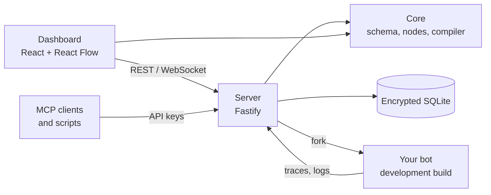

<p align="center">
  <picture>
    <source media="(prefers-color-scheme: dark)" srcset="docs/brand/logo/open-sila-horizontal-color-dark.svg" />
    
  </picture>
</p>

<p align="center">
  <strong>Build Discord and Telegram bots on a visual canvas. Run them locally. Export plain Node.js code.</strong>
</p>

<p align="center">
  <a href="LICENSE"></a>
  
  
  
</p>

<p align="center">
  <a href="#quick-start">Quick start</a> ·
  <a href="#features">Features</a> ·
  <a href="#exporting-and-hosting">Hosting</a> ·
  <a href="docs/api.md">REST API</a> ·
  <a href="docs/mcp.md">MCP</a> ·
  <a href="CONTRIBUTING.md">Contributing</a>
</p>

---

**Open Sila** (from صلة, *connection*) is a self-hosted editor for chat bots. You wire triggers, actions and data on a canvas, press **Run** to start the bot on your machine, watch every node light up as it executes, and export a readable Node.js project with no runtime dependency on Open Sila.

## Quick start

Requires **Node.js 20.12 or newer** (22 or 24 LTS recommended).

```bash
git clone https://github.com/0xRoony/open-sila.git
cd open-sila
npm install
npm run build
npm start
```

The server prints a one-time sign-in link:

```text
Dashboard http://127.0.0.1:4590/login?token=...
```

Open it, create a project from the **Ping command** template, add your bot token under **Secrets**, and press **Run**.

<details>
<summary><strong>Getting a bot token</strong></summary>

- **Discord:** create an application in the [Developer Portal](https://discord.com/developers/applications), open **Bot**, reset and copy the token, and invite the bot with the `bot` and `applications.commands` scopes. Add `DISCORD_GUILD_ID` as a secret to register slash commands on your test server instantly.
- **Telegram:** message [@BotFather](https://t.me/BotFather), send `/newbot` and copy the token.

</details>

## Features

### Editor

- Typed ports for exec order and data. Compatible values convert on the wire, and the wire shows the conversion.
- Text inputs accept several wires and mix them with your own text through `{{ $1 }}`; any input without a wire takes a JavaScript expression.
- Command palette (<kbd>Ctrl</kbd>+<kbd>P</kbd>), outline, sticky notes, align and distribute, auto arrange, undo and redo, copy and paste between projects.
- Version history, saved automatically each time the bot starts.
- 18 templates: leaderboard with a database, role buttons, feedback form, quiz, Telegram Stars shop, scheduled reminders, webhooks and more.

### Nodes

| | Nodes | Highlights |
| --- | --: | --- |
| **Discord** | 97 | Slash commands with subcommands, choices, autocomplete, permissions and translations; buttons, select and user/role/channel pickers; forms; embeds; native polls; threads and forums; roles, moderation, AutoMod, audit log, scheduled events, voice moves and every gateway event |
| **Telegram** | 66 | Commands, media, inline and reply keyboards, inline queries, polls and quizzes, albums, reactions, forum topics, admin rights, join requests, Mini Apps and payments with Telegram Stars |
| **Shared** | 54 | Logic, loops, Try/Catch, cooldowns, HTTP requests, incoming webhooks, cron schedules, regex, dates, JSON, memory, persistent storage and database records |

### Data

- Define models in the **Data** panel and use them through Create, Find, Update, Save, Delete and Count nodes.
- Backed by [Prisma](https://www.prisma.io) with SQLite, PostgreSQL, MySQL, MongoDB, SQL Server or CockroachDB.
- SQLite needs no setup: the bot gets a local file automatically.

### Running and debugging

- One click builds and starts the bot; crashes restart it with backoff.
- The **Runs** panel records every execution with each node's inputs and outputs. Hover a wire to see the last value it carried.
- The **Network** panel captures outgoing HTTP requests, with secrets masked.
- **Manual run** triggers send a sample payload to a flow without opening Discord or Telegram.

### Integrations

- REST API and a stateless MCP endpoint, both authenticated with read-only or read-write API keys.
- Project files (`.sila.json`) for sharing and backups, with import by drag and drop.

## Exporting and hosting

**Export › Bot code** produces a standalone project:

```text
my-bot/
├── src/
│   ├── index.js          # client setup, graceful shutdown, JSON logs
│   ├── handlers/         # one file per trigger
│   └── lib/              # only the helpers the flow uses
├── prisma/schema.prisma  # only when the flow uses the database
├── Dockerfile
├── railway.json
├── fly.toml
├── .env.example
└── README.md             # intents, permissions and setup for this bot
```

The output depends only on what the flow uses: `discord.js` or `grammy`, plus Prisma for databases. An HTTP server with a `/health` endpoint is added only when the flow has an incoming webhook. Deploy with `npm install && npm start`, Docker, Railway, Fly.io or any Node.js host. Discord bots also get a sharding entry point (`npm run start:shards`).

## How it works



| Package | Role |
| --- | --- |
| [`packages/core`](packages/core) | Flow schema, node catalog, validation and code generator. Runs in Node and in the browser, so the canvas shows the same errors the compiler would. |
| [`packages/server`](packages/server) | Fastify server and the `sila` CLI: REST API, MCP endpoint, WebSocket events, encrypted store and bot runner. |
| [`apps/dashboard`](apps/dashboard) | The editor, built with Vite and served by the server. |

More detail in [docs/architecture.md](docs/architecture.md).

## API, MCP and CLI

```bash
npx sila keys create "CI" --read-only
curl -H "Authorization: Bearer osk_..." http://127.0.0.1:4590/api/v1/projects
```

Add Open Sila to an MCP client:

```bash
claude mcp add --transport http open-sila http://127.0.0.1:4590/mcp --header "Authorization: Bearer osk_..."
```

| Command | Description |
| --- | --- |
| `sila start [--port] [--host] [--data-dir]` | Start the server |
| `sila keys list` | List API keys |
| `sila keys create <name> [--read-only]` | Create an API key; the secret is shown once |
| `sila keys revoke <id>` | Revoke an API key |

See [docs/api.md](docs/api.md) and [docs/mcp.md](docs/mcp.md).

## Configuration

| Variable | Default | Description |
| --- | --- | --- |
| `OPEN_SILA_HOME` | `~/.open-sila` | Data directory: database, builds and bot data |
| `OPEN_SILA_PORT` | `4590` | Port |
| `OPEN_SILA_HOST` | `127.0.0.1` | Bind address |
| `OPEN_SILA_KEY` | generated | 64 hex characters used as the database key. Without it, a key is generated into `master.key` in the data directory |
| `OPEN_SILA_PUBLIC_URL` | `http://<host>:<port>` | Public URL when running behind a reverse proxy |
| `OPEN_SILA_ALLOWED_HOSTS` | | Extra `Host` headers to accept, comma separated |

## Security

Open Sila is built to run on your own machine. The server binds to `127.0.0.1`, rejects unknown `Host` headers, encrypts its database, never returns stored tokens, and hashes API keys. The JavaScript node runs inside your bot without a sandbox, so only run flows you trust. See [SECURITY.md](SECURITY.md) for the full model and how to report a vulnerability.

## Development

```bash
npm run dev:server      # server with reload on http://127.0.0.1:4590
npm run dev:dashboard   # Vite dev server on http://127.0.0.1:5173
npm run typecheck
npm test
```

The test suite compiles every node in development and production mode, runs the generated code of every node against mocked discord.js and grammY clients in four scenarios, runs all templates end to end, and covers the REST API and MCP endpoint. See [CONTRIBUTING.md](CONTRIBUTING.md) to add a node.

## License

[MIT](LICENSE). When using the Open Sila logo, follow the [brand guidelines](docs/brand/README.md).
